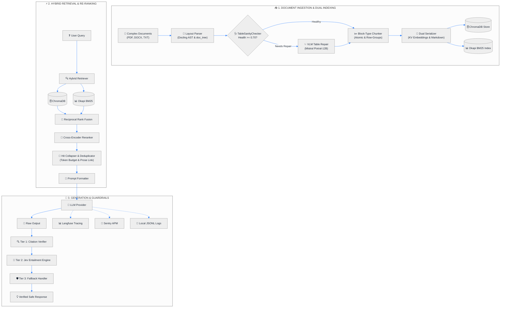

# ⚡ Production-Grade Document RAG Engine

> **Enterprise-grade Document RAG with IBM Docling AST parsing, automated VLM table repair (Pixtral-12B), dual-representation serialization, hybrid RRF retrieval, deterministic guardrails, and sub-2s latency.**

[](https://www.python.org/downloads/)
[](https://github.com/DS4SD/docling)
[](https://mistral.ai)
[](#-retrieval-engine)
[](#-getting-started)
[](reports/sample_tables_rag_evaluation_report.md)
[](reports/sample_tables_rag_evaluation_report.md)
[](LICENSE)

---

## 🎯 Architectural Philosophy: First-Principles over Heavy Frameworks

This project intentionally avoids heavy wrapper abstractions (like LangChain or LlamaIndex) in favor of **First-Principles AI Engineering**:

* **🔍 Full Transparency & Zero "Black Box"**: Every algorithm—from Okapi BM25 scoring and Reciprocal Rank Fusion (RRF) to cross-encoder re-ranking and semantic caching—is implemented natively without layers of obscure wrapper classes.
* **⚡ High Performance & Low Latency**: Native Python and direct official SDKs eliminate framework overhead, resulting in sub-millisecond local execution and lightning-fast test suites.
* **🛠️ Production Debuggability**: Traceability is straightforward: no hidden prompt injections, memory leaks, or unhandled exceptions buried deep within third-party abstractions.
* **🔌 Framework-Agnostic & Agent-Ready**: Every module is a typed, standalone component that can easily plug into orchestration frameworks (e.g., LangGraph, AutoGen) if complex cyclic workflows are needed.

## 🔄 End-to-End Workflow & System Architecture

Here is the exact flow of data and component execution across the two main pipelines: **Document Ingestion** and **RAG Query Execution**.

#### 📊 Visual Architecture Diagram



### 🗺️ Text Architecture Overview

```text
===================================================================================
                       RAG SYSTEM ARCHITECTURE & DATAFLOW
===================================================================================

 📥 INGESTION:   [ 📄 Documents ] ──► [ 🌳 Docling Layout AST ] ──► [ 🩺 TableSanityChecker ]
                                                                             │
                                           ┌─────────────────────────────────┴─────────────────────────────────┐
                                           ▼                                                                   ▼
                                  [ Needs Repair (<0.70) ]                                                [ Healthy ]
                                           │                                                                   │
                                           ▼                                                                   │
                              [ ✨ Mistral Pixtral VLM ]                                                       │
                                           │                                                                   │
                                           └─────────────────────────────────┬─────────────────────────────────┘
                                                                             ▼
                                                                  [ ✂️ BlockChunker ]
                                                                  (Atomic & Row-Groups)
                                                                             │
                                                                             ▼
                                                                [ 🔄 Dual Serializer ]
                                                                (KV Text & Clean MD)
                                                                             │
                                                       ┌─────────────────────┴─────────────────────┐
                                                       ▼                                           ▼
                                             [ 🗄️ ChromaDB Store ]                       [ 📊 Okapi BM25 Index ]
                                                   (Dense)                                       (Sparse)
 ── ── ── ── ── ── ── ── ── ── ── ── ── ── ── ── ── ── │ ── ── ── ── ── ── ── ── ── ── ── ── ── ── │ ── ── ── ── ──
                                                       ▼                                           ▼
 ⚡ QUERYING:    [ ❓ User Query ] ──► [ 🔍 Hybrid Search & RRF Fusion ]
                                                       │
                                                       ▼
                                              [ 🎯 Cross-Encoder Reranker ]
                                                       │
                                                       ▼
                                              [ 🧩 HitCollapser & Sibling Deduplicator ]
                                              (Context Budgeting & Story Linking)
                                                       │
                                                       ▼
                                              [ 📝 Prompt Formatter ]
                                                       │
                                                       ▼
 🤖 GENERATION:                               [ 💬 LLM (Mistral/Gemini) ]
                                                       │
                                                       ▼
 🛡️ GUARDRAILS:                               [ 🔍 Tier 1: Citation Verifier ]
                                                       │
                                                       ▼
                                              [ 🧠 Tier 2: Jev Entailment Engine ]
                                                       │
                                                       ▼
                                              [ 🚨 Tier 3: Safe Fallback Handler ]
                                                       │
                              ┌────────────────────────┴────────────────────────┐
                              ▼                                                 ▼
                       [ 💡 Verified Safe Response ]             [ 📊 Telemetry & Monitoring ]
                                                                 ├─► Langfuse (Traces & Costs)
                                                                 ├─► Sentry (Exceptions & APM)
                                                                 └─► Local JSONL Logs
===================================================================================
```


### ⚙️ Step-by-Step Breakdown

#### 1. Ingestion & Indexing Phase (`POST /index` & `DELETE /index`)
* **Docling Layout Analysis & AST Building**: `LayoutParser` extracts structural blocks (`SectionHeaderItem`, `TableItem`, `TextItem`, `CodeItem`) into a typed hierarchy (`DocumentTree`) with section breadcrumbs and table-to-prose linkages.
* **Extraction & Table Health Sanity Checks**: 
  - `ExtractionQualityScorer` calculates $Q_{score} \in [0.0, 1.0]$ based on text cleanliness and character noise.
  - `TableSanityChecker` inspects table column alignment, missing cell voids, and jagged row lengths.
* **VLM Table Repairer**: If a table fails sanity checks (e.g., column-swapped borderless grid), it routes page images to Mistral's **`pixtral-12b-2409`** multimodal model to visually transcribe the exact table into pristine Markdown.
* **Block-Type Chunking**: `BlockChunker` keeps small tables ($\le 25$ rows) atomic and slices oversized tables into row-groups with replicated schema headers.
* **Dual Representation Serialization**: `TableSerializer` produces linearized Key-Value sentences for vector embeddings and Markdown tables for LLM prompt context.
* **Dual Indexing**: Upserts dense representations into `ChromaDB` and sparse lexical statistics into `Okapi BM25`.

#### 2. Querying, Caching & Generation Phase (`POST /query`)
1. **Semantic Cache Lookup**: Evaluates query cosine similarity against cached vectors (`similarity_threshold >= 0.95`). If a verified cached response exists, returns immediately ($0 LLM cost, ~5-15ms latency).
2. **Tracing Started**: `Tracer` creates a unique `trace_id` for distributed observability.
3. **Hybrid Retrieval (`Retriever`)**:
   * Runs **Dense Vector Search** and **Sparse BM25 Search** in parallel.
   * **Reciprocal Rank Fusion (RRF)** combines candidate lists into a unified score array.
   * **Cross-Encoder Reranker** scores top candidates jointly with the query.
4. **Hit Collapser & Sibling Deduplication**: `HitCollapser` groups sibling row-chunks belonging to the same table ID, pulls introductory prose (`preceding_prose_id`), and caps context within token budgets.
5. **Prompt Formatting**: `format_rag_prompt()` injects structured Markdown tables and prose into strict grounding templates.
6. **LLM Generation**: `LLMClient` calls the selected provider (`Mistral`, `Gemini`, `OpenAI`, or `Anthropic`) to generate the raw response.
7. **Multi-Tier Guardrail Verification**:
   * **Tier 1 (Citation Verifier)**: Deterministic regex parsing validating that numeric citations (`[1]`, `[2]`) and file sources exist within context.
   * **Tier 2 (Hallucination Detector & Jev)**: Decomposes assertions into claims and verifies entailment via the **Jev** discriminative decision engine.
   * **Tier 3 (Fallback Handler)**: In strict mode, intercepts citation failures or ungrounded statements and returns a safe refusal message.
8. **Cache Storage**: Verified, approved answers are saved into the bounded LRU semantic cache with TTL.

#### 3. Observability & Monitoring Phase
* **Langfuse Tracing**: Exports hierarchical trace trees (retrieval duration, prompt payload, generation latency, guardrail execution, and token counts) to Langfuse.
* **Sentry Error Monitoring**: Intercepts unhandled ASGI exceptions and logs APM profiling sessions to Sentry.
* **Local JSONL Logging**: Appends execution logs locally in `logs/traces.jsonl`.

---

## 🗺️ Production Roadmap

The repository follows a structured engineering roadmap detailed in the [`plans/`](plans/) directory:

| Plan | Title | Status | Description |
| :--- | :--- | :---: | :--- |
| **[Plan 1](plans/plan1.md)** | **Advanced Hybrid Retrieval & Re-ranking** | ✅ Complete | Sparse BM25 + Dense Vector search with Reciprocal Rank Fusion (RRF), Cross-Encoder Re-ranking, and Contextual Sentence Compression. |
| **[Plan 2](plans/plan2.md)** | **Evaluation Engine (LLM-as-a-Judge)** | ✅ Complete | Precision@K, Recall@K, Hit Rate, MRR, Faithfulness / Groundedness, and automated Golden Dataset benchmarking. |
| **[Plan 3](plans/plan3.md)** | **Failure Modes & Guardrails (Jev)** | ✅ Complete | Multi-tiered guardrails with deterministic citation bounds checking, statement entailment via Jev discriminative decision model, and safe fallback handling. |
| **[Plan 6](plans/plan6.md)** | **Observability & Sentry Error Monitoring** | ✅ Complete | End-to-end span tracing (`Tracer`), operational metrics (`MetricsCollector`), Langfuse observability, and Sentry APM error monitoring. |
| **[Plan 4](plans/plan4.md)** | **Cost & Latency Optimization** | ✅ Complete | Semantic vector query cache ($0 repeat cost), query complexity router (Flash vs. Pro), and token/latency profiler. |
| **[Plan 7](plans/plan7.md)** | **Complex Document Ingestion & Chunking** | ✅ Complete | Docling layout AST engine, TableSanityChecker, Pixtral VLM table repair fallback, dual serialization (KV & MD), and runtime HitCollapser. |
| **[Plan 8](plans/plan8.md)** | **Advanced Table Health Verification** | ✅ Complete | Verbatim Source Grounding (lexical page matching via pypdfium2) and Pure Total Column Math Reconciliation (with accounting parentheses). |
| **[Plan 5](plans/plan5.md)** | **System Design & 100x Scaling (ADRs)** | ⏳ Pending | Architecture Decision Records (RAG vs. Fine-Tuning, 100x scale sharding, decoupled AST caching), and Senior AI Interview Cheat Sheet. |


---

## 📁 Project Structure

```
Rag_Full_Version/
├── README.md                      # Project description, philosophy, and setup guide
├── requirements.txt               # Dependencies (FastAPI, Docling, ChromaDB, Mistral, etc.)
├── Dockerfile                     # Multi-stage security-hardened container specification
├── docker-compose.yml             # Container orchestration with persistent volumes
├── .dockerignore                  # Docker build context exclusions
├── .env / .env.example            # Environment variables and API keys
├── .gitignore                     # Git ignore definitions
├── config.yaml                    # Central configuration file
├── AGENTS.md                      # Coding standards & agent instructions
├── main.py                        # Service entry point
├── docs/                          # Comprehensive architectural guides & benchmarks
│   ├── CHUNKING_AND_INGESTION_ARCHITECTURE.md # 7-stage block chunking & dual serialization
│   ├── DOCLING_VS_MISTRAL_OCR.md         # Docling vs Mistral OCR trade-offs, pricing & hybrid VLM
│   ├── GUARDRAILS_AND_FALLBACK_GUIDE.md  # 3-Tier guardrails, Jev entailment & fallback
│   ├── RETRIEVAL_METRICS_AND_SCORES.md   # Distance, BM25, RRF & Cross-Encoder scores
│   ├── EVALUATION_METRICS_GUIDE.md       # Precision@K, Recall@K, MRR & LLM Judge
│   ├── TOP_K_TUNING_GUIDE.md             # Two-stage retrieval sizing & cost tuning
│   └── OBSERVABILITY_VS_MONITORING.md    # Langfuse semantic tracing vs Sentry APM
├── plans/                         # Step-by-step engineering plans
│   ├── plan1.md                   # Plan 1: Hybrid Retrieval & Re-ranking (Done)
│   ├── plan2.md                   # Plan 2: Evaluation & Metrics Engine (Done)
│   ├── plan3.md                   # Plan 3: Failure Modes & Guardrails (Done)
│   ├── plan4.md                   # Plan 4: Cost & Latency Optimization (Done)
│   ├── plan5.md                   # Plan 5: System Design & Scaling ADRs
│   ├── plan6.md                   # Plan 6: Observability & Sentry Monitoring (Done)
│   └── plan7.md                   # Plan 7: Complex Document Ingestion & Table Chunking (Done)
├── scripts/                       # Operational scripts & benchmarking CLIs
│   ├── test_pdf_chunking.py       # PDF layout inspection, table sanity & chunk provenance CLI
│   └── eval_chunking_benchmark.py # 25-question retrieval benchmark on complex tables
├── .agents/
│   └── skills/
│       └── rag-conventions/
│           └── SKILL.md           # Custom skill for naming conventions and docstrings
├── src/
│   ├── ingestion/                 # Document layout extraction & tree modeling
│   │   ├── __init__.py
│   │   ├── doc_tree.py            # Hierarchical DocumentNode AST & section breadcrumbs
│   │   ├── layout_parser.py       # Dedicated Docling layout engine & disambiguation
│   │   ├── quality_scorer.py      # Q_score extraction scorer & TableSanityChecker
│   │   └── loader.py              # Directory file loader
│   ├── chunking/                  # Block-type chunking & table serializers
│   │   ├── __init__.py
│   │   ├── block_chunker.py       # Atomic small tables & row-grouping with replicated headers
│   │   ├── table_parser.py        # Multi-row fill-down & headerless page stitcher
│   │   ├── table_serializer.py    # KV linearization for embeddings & Markdown for LLM
│   │   ├── table_repairer.py      # VLM table repair fallback (Mistral Pixtral-12B)
│   │   ├── chunker.py             # Recursive text chunker (fallback/baseline)
│   │   └── compression.py         # Contextual sentence compressor
│   ├── embeddings/                # Vector embeddings (SentenceTransformers, OpenAI, Gemini)
│   │   ├── __init__.py
│   │   └── embedder.py
│   ├── vectordb/                  # Vector database (ChromaDB, FAISS, in-memory)
│   │   ├── __init__.py
│   │   └── vector_store.py
│   ├── retrieval/                 # Unified search engine, hybrid rankers & deduplicators
│   │   ├── __init__.py
│   │   ├── hit_collapser.py       # Table sibling deduplication & token budgeter
│   │   ├── bm25_retriever.py      # Okapi BM25 keyword search
│   │   ├── hybrid_retriever.py    # Reciprocal Rank Fusion (RRF)
│   │   ├── reranker.py            # Cross-Encoder re-ranker
│   │   └── retriever.py           # Unified Retriever Facade
│   ├── guardrails/                # Multi-tier guardrails & hallucination prevention
│   │   ├── __init__.py
│   │   ├── citation_verifier.py   # Tier 1 deterministic citation bounds checker
│   │   ├── hallucination_detector.py # Tier 2 claim-level entailment verifier
│   │   ├── jev_client.py          # Fast discriminative decision model client
│   │   └── fallback_handler.py    # Tier 3 policy enforcement & safe fallback
│   ├── optimization/              # Cost & latency optimization (Plan 4)
│   │   ├── __init__.py
│   │   ├── semantic_cache.py      # Bounded LRU semantic vector cache
│   │   ├── query_router.py        # Complexity-based query router
│   │   └── profiler.py            # Latency and cost profiler
│   ├── prompts/                   # Prompt templates & context formatting
│   │   ├── __init__.py
│   │   └── prompt_templates.py
│   ├── llm/                       # LLM provider clients (Mistral, Gemini, OpenAI)
│   │   ├── __init__.py
│   │   └── llm_client.py
│   ├── observability/             # Distributed tracing, APM, and metrics
│   │   ├── __init__.py
│   │   ├── tracer.py
│   │   ├── metrics_collector.py
│   │   ├── sentry_monitor.py
│   │   └── span_exporter.py
│   ├── api/                       # FastAPI REST endpoints
│   │   ├── __init__.py
│   │   └── routes.py
│   └── utils/                     # Config loader, helpers, structured logger
│       ├── __init__.py
│       └── helpers.py
├── tests/                         # Unit & integration test suites
│   ├── __init__.py
│   ├── test_app.py
│   ├── test_block_chunking.py
│   ├── test_table_health.py
│   ├── test_table_repairer.py
│   ├── test_ugly_table_fixture.py
│   ├── test_guardrails.py
│   ├── test_hybrid_retriever.py
│   ├── test_evaluation.py
│   ├── test_observability.py
│   └── test_optimization.py
├── reports/                       # Generated benchmark & document inspection reports
└── logs/                          # Application log files
    └── .gitkeep

```

---

## 🚀 Getting Started

### Option A: Running with Docker (Recommended)

Run the entire RAG pipeline—including IBM Docling neural layout models, ChromaDB vector persistence, and FastAPI server—inside an isolated, production-ready container with a single command:

#### 1. Configure Environment
```bash
cp .env.example .env
# Fill in your MISTRAL_API_KEY (and optional LANGFUSE / SENTRY keys) in .env
```

#### 2. Start Services via Docker Compose
```bash
docker compose up --build -d
```

- **Interactive Swagger Docs**: [http://localhost:8000/docs](http://localhost:8000/docs)
- **Health Check Endpoint**: [http://localhost:8000/health](http://localhost:8000/health)
- **Real-Time Container Logs**: `docker compose logs -f`
- **Graceful Shutdown**: `docker compose down`

> [!TIP]
> The `docker-compose.yml` mounts `./data`, `./chroma_db`, and `./reports` directly as host volumes. You can drop new PDFs into `data/` and see index changes and reports persist immediately without rebuilding the image.

---

### Option B: Local Python Environment

#### 1. Installation
Create and activate a virtual environment, then install dependencies:

```bash
python -m venv .venv
# On Windows:
.venv\Scripts\activate
# On Linux/macOS:
source .venv/bin/activate

pip install -r requirements.txt
```

#### 2. Configure Environment
```bash
cp .env.example .env
```

#### 3. Run the Application
Start the FastAPI server:

```bash
python main.py
```

* API Docs (Swagger): `http://localhost:8000/docs`
* Health Check: `http://localhost:8000/health`

#### 4. Inspect Document Chunking & Table Health
To inspect how any document is parsed, chunked, and validated:

```bash
python scripts/test_pdf_chunking.py data/sample-tables.pdf
```
This generates a detailed inspection report in `reports/inspection_sample-tables.md` displaying table sanity health scores, relational links, and dual representations.

---

## 🧪 Running Tests

Run the test suite using `pytest`:

```bash
pytest -v
```

---

## 📚 In-Depth Documentation

* [**Chunking & Ingestion Architecture Guide**](docs/CHUNKING_AND_INGESTION_ARCHITECTURE.md): Comprehensive 7-stage guide on Docling AST layout parsing, TableSanityChecker, Pixtral VLM repair, block-type chunking, dual serialization, and runtime hit collapsing.
* [**Token Budget & Context Window Management Guide**](docs/TOKEN_BUDGET_AND_CONTEXT_MANAGEMENT.md): Multi-tier token hierarchy, embedding truncation protection, dynamic row windowing, and prompt budget enforcement.
* [**Docling vs. Mistral OCR & Vision LLMs**](docs/DOCLING_VS_MISTRAL_OCR.md): In-depth comparison of multi-model layout engines vs. end-to-end vision models, pricing economics ($0.00 vs. $4/1k pages), and the 95/5 hybrid production pattern.
* [**Guardrails & Hallucination Prevention Guide**](docs/GUARDRAILS_AND_FALLBACK_GUIDE.md): 3-tier guardrail architecture using Jev discriminative entailment, regex citation bounds verification, fallback trigger mechanics, and zero-downtime execution.
* [**Retrieval Metrics and Scoring Guide**](docs/RETRIEVAL_METRICS_AND_SCORES.md): Complete breakdown of `distance`, `score`, `bm25_score`, `rrf_score`, and `rerank_score`, including mathematical formulas, healthy ranges, and real-world interpretations.
* [**Evaluation Metrics & Benchmark Guide**](docs/EVALUATION_METRICS_GUIDE.md): Mathematical breakdown of Precision@K, Recall@K, Hit Rate, MRR, and LLM-as-a-Judge generation metrics (Faithfulness & Relevance) with live benchmark results.
* [**Top-K Tuning & Retrieval Sizing Guide**](docs/TOP_K_TUNING_GUIDE.md): Practical guide on how to choose optimal $K$, why the $4\times$ candidate multiplier is used, and how to balance Recall vs. prompt cost.
* [**Observability vs. Monitoring Guide**](docs/OBSERVABILITY_VS_MONITORING.md): Architectural guide explaining how semantic observability (Langfuse) catches "silent" RAG failures that traditional APMs (Sentry/Datadog) miss.


---

## 📐 Conventions & Standards

- **Naming**: `snake_case` for modules/functions/variables, `PascalCase` for classes, `UPPER_SNAKE_CASE` for constants.
- **Docstrings**: Concise Google-style Python docstrings for all functions, classes, and modules.
- **Rules & Skills**: Defined in [`AGENTS.md`](AGENTS.md) and [`.agents/skills/rag-conventions/SKILL.md`](.agents/skills/rag-conventions/SKILL.md).

---

## 🤝 Contributing

Contributions are welcome! Please read [CONTRIBUTING.md](CONTRIBUTING.md) for details on our code of conduct, development workflow, architecture guidelines, and pull request checklist.

---

## 📄 License

This project is licensed under the **MIT License** - see the [LICENSE](LICENSE) file for details.

