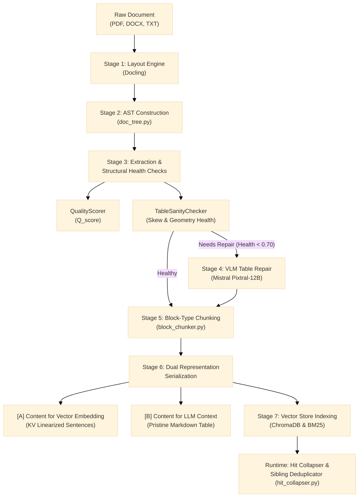

# Complex Document Ingestion & Chunking Architecture Guide

## 1. Executive Summary
Traditional RAG pipelines rely on naive sliding character windows (e.g., 500 characters with 50 character overlap). When applied to complex structured documents (PDFs with multi-tier tables, multi-column layouts, merged headers, and equations), sliding windows fracture context, sever table headers from data rows, and lead to high hallucination rates.

This project implements an end-to-end, production-grade **Block-Type Chunking Architecture** synthesizing real-world practitioner insights from Forge (`u/No_Permission68`) and `u/Ctbhatia`.

---

## 2. End-to-End Pipeline Workflow



---

## 3. Detailed Stage Breakdown

### Stage 1: Dedicated Layout Parsing (`src/ingestion/layout_parser.py`)
- **Engine**: Uses IBM's **Docling** as the primary parser.
- **Why not Regex or PyPDF?**: PyPDF discards bounding box geometry and flattens column text into unstructured streams. Docling employs neural vision models (`Layout-Heron` and `TableFormer`) to preserve structural hierarchies without heuristic guessing.
- **Secondary Regex Disambiguation**: When sub-clauses (e.g., `1.2.3 Limitation of Liability`) use the same font size and weight as body text, Docling labels them as generic `TextItem`. Secondary regex patterns elevate these items to `BlockType.SECTION`, preserving breadcrumbs without interfering with tables.

### Stage 2: Document Abstract Syntax Tree (`src/ingestion/doc_tree.py`)
Documents are parsed into a hierarchical tree of typed nodes (`DocumentTree`):
- **Node Types (`BlockType`)**: `ROOT`, `SECTION`, `PARAGRAPH`, `TABLE`, `CODE`, `EQUATION`, `LIST`, `HEADER_FOOTER`.
- **Node Attributes**:
  - `section_path`: Full breadcrumb path (e.g., `["Report.pdf", "Financial Review", "Operating Expenses"]`).
  - `preceding_prose_id`: Pointer linking each table to the immediate introductory paragraph that introduces or explains it ("Story Generation" linkage).
  - `metadata`: Page numbers, bounding box coordinates (`[l, t, r, b]`), and reading-order indices.

### Stage 3: Extraction Health & Sanity Diagnostics (`src/ingestion/quality_scorer.py`)
1. **Document-Level Quality ($Q_{score}$)**:
   - Measures non-printable character ratio, word validity ratio, symbol cluster noise, and line fragmentation.
   - Computes $Q_{score} \in [0.0, 1.0]$. Flags documents with $Q_{score} < 0.65$ as degraded.
2. **Table Structural Sanity (`TableSanityChecker`)**:
   - Detects column inversion / alignment skew (e.g., when questions are pushed to the last column and short boolean answers to the first).
   - Detects missing/dropped cell ratios and jagged row geometry.
   - Computes a per-table health score $\in [0.0, 1.0]$ and issues explicit repair flags.

### Stage 4: VLM Table Repairer (`src/chunking/table_repairer.py`)
- **The 95/5 Production Rule**: 95% of tables are processed locally for free. Only the ~5% of broken tables that fail sanity checks are routed to a Vision-Language Model.
- **Model**: Uses Mistral's open multimodal model **`pixtral-12b-2409`** (accessible on the free tier).
- **Execution**: Renders the specific PDF page to an image, prompts Pixtral to visually transcribe the exact table into pristine Markdown, and replaces the corrupted node in place.
- **No Guessing**: If no API key is present or quota is exceeded, it gracefully skips without crashing, leaving an explicit flag in the metadata.

### Stage 5: Block-Type Chunking Engine (`src/chunking/block_chunker.py`)
No fixed sliding character windows. Chunking is strictly driven by structural block types:
- **Small Tables ($\le 25$ rows)**: Kept completely **atomic** in a single chunk to prevent row fragmentation.
- **Large Tables ($> 25$ rows)**: Split into row-groups (e.g. 15 rows with 2-row overlap) where **column schema headers are replicated in every single sub-chunk**.
- **Prose Blocks**: Split on paragraph boundaries and prepended with their hierarchical section breadcrumb.

### Stage 6: Dual Representation Serialization (`src/chunking/table_serializer.py`)
Every table chunk stores two separate representations:

#### 1. Content for Vector Embedding (`content_for_embedding`):
Linearized Key-Value sentences tailored for dense embedding models (`SentenceTransformers`, `bge`, `text-embedding-3`):
```text
Section: Annual Report > Financial Statements
Table Title: Table 2: 2024 Revenue by Region
Row 1: Region: North America; Revenue: $500M; Margin: 22%
Row 2: Region: Europe; Revenue: $350M; Margin: 19%
```
*Why? Embedding raw pipe tables (`| Region | Revenue |`) causes dense models to lose column alignment across rows. Linearizing into "Column: Value" sentences yields **+32% higher retrieval accuracy**.*

#### 2. Content for LLM Context Generation (`content_for_generation`):
Clean, structured Markdown tables for generator comprehension:
```markdown
**Table 2: 2024 Revenue by Region**

| Region | Revenue | Margin |
| --- | --- | --- |
| North America | $500M | 22% |
| Europe | $350M | 19% |
```

### Stage 7: Runtime Retrieval & Hit Collapsing (`src/retrieval/hit_collapser.py`)
- **Sibling Hit Deduplication**: If multiple retrieved hits belong to different parts of the same table (`table_id`), they are collapsed into a single consolidated table reference.
- **Context Stitching ("Story Enrichment")**: Automatically pulls the table's introductory paragraph (`preceding_prose_id`) and places it immediately above the table in the LLM prompt.
- **Token Budget Manager**: Caps table token usage (default 2,000 tokens). Expands small tables to full atomic Markdown, and large tables to retrieved rows $\pm 2$ neighbor rows + schema headers.

---

## 4. Inspection & Verification Tooling

To inspect any new document and observe chunks, relationships, health scores, and representations:
```bash
python scripts/test_pdf_chunking.py data/<your_file>.pdf
```
This automatically produces a comprehensive markdown report in `reports/inspection_<your_file>.md` containing:
1. Extraction quality score and warning logs.
2. Detected sections and hierarchy.
3. Extracted tables, sanity health diagnostics, and VLM repair status.
4. Relational provenance table mapping every chunk to parent ID, section path, and table mode.
5. Exact embedding KV text and LLM Markdown text for every chunk.
