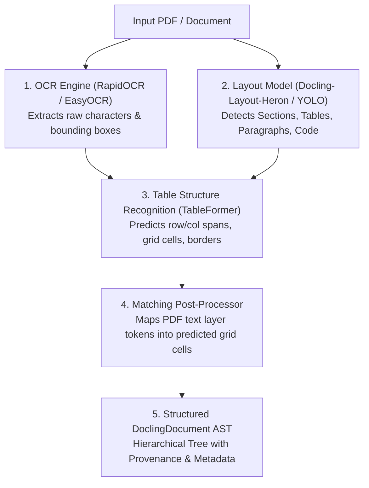
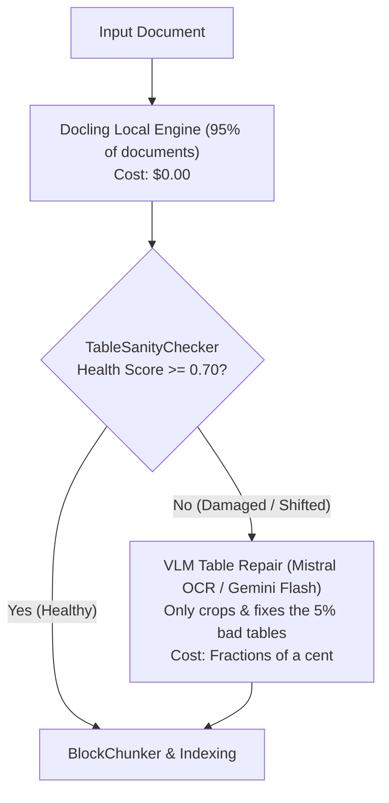

# Document Ingestion Architecture: Docling vs. Mistral OCR & Vision LLMs

## Overview
Extracting structured data (especially complex, borderless, multi-level tables, and equations) from PDFs into high-quality chunks is the single biggest bottleneck in production RAG systems.

This document details:
1. What **Docling** is and its internal multi-model architecture.
2. What **Mistral OCR** is and how it compares.
3. Why teams choose Docling vs. Mistral OCR (Costs, Privacy, Speed, and Trade-offs).
4. The **Hybrid Production Pattern**: Local Docling + VLM Table Repair fallback.

---

## 1. What is Docling? Is it an OCR?

**Docling is NOT a simple OCR wrapper.** It is an open-source, multi-modal **Document Layout Analysis & AST Orchestration Engine** developed by IBM Research.

When a document runs through Docling, several specialized neural models work together:

### Docling Components:
- **`RapidOCR` / `EasyOCR`**: Handles optical character recognition for scans or flat images.
- **`Layout-Heron`**: Vision model that classifies visual blocks (`SectionHeaderItem`, `TableItem`, `TextItem`).
- **`TableFormer`**: A dedicated transformer model for table structures. It predicts cell adjacency matrices without reading text semantics.
- **`MatchingPostProcessor`**: Matches visual bounding boxes back to the PDF text stream.

---

## 2. What is Mistral OCR?

**Mistral OCR** (and models like Google Cloud Document AI or Pixtral-based OCR) uses an **End-to-End Vision-Language Architecture**.

Instead of breaking extraction into 4 separate modular steps (OCR &rarr; Layout &rarr; Grid Matrix &rarr; Matching), an end-to-end VLM:
1. Takes the entire page image as visual tokens.
2. Understands layout, language context, and reading order in a single unified transformer pass.
3. Emits pristine, structured Markdown or JSON directly.

---

## 3. Why Don't People Just Use Mistral OCR Directly? Why Bother with Docling?

If Mistral OCR is so clean, why does the enterprise industry still heavily rely on tools like Docling, Unstructured, or Marker?

### Cost Comparison

| Model / Service | Price per 1,000 Pages | Cost for 100,000 Pages | Cost for 1,000,000 Pages |
| :--- | :--- | :--- | :--- |
| **Docling** (Local / Self-Hosted) | **$0.00** (Free / Compute Only) | **$0.00** | **$0.00** |
| **Mistral OCR (Batch API)** | **$0.40 - $2.00** | $40 - $200 | $400 - $2,000 |
| **Mistral OCR (Standard API)** | **$4.00** ($0.004 / page) | $400 | $4,000 |
| **AWS Textract (Tables + Queries)**| **$15.00 - $65.00** | $1,500 - $6,500 | $15,000 - $65,000 |

While **$0.004 per page** sounds cheap for 50 pages ($0.20), in production enterprise RAG systems processing millions of internal regulatory filings, invoices, clinical trials, or contract archives, API bills scale to tens of thousands of dollars on recurring ingestions.

### Direct Comparison Matrix

| Factor | Docling (Open Source) | Mistral OCR (Cloud API) |
| :--- | :--- | :--- |
| **Data Privacy & Compliance** | **100% Local / On-Premise**. Documents never leave your VPC/hardware (critical for HIPAA, banking, defense, GDPR). | Cloud API. Data is transmitted to third-party servers unless self-hosting large vision models. |
| **Cost** | Free open-source license (MIT/Apache). | Pay-per-page recurring API fee. |
| **Network & Offline** | Works completely offline, air-gapped, or in secure enclaves. | Requires internet connectivity and API key rate limits. |
| **Layout AST Access** | Rich object model: exposes exact bounding box coordinates (`l, t, r, b`), character spans, and page numbers. | Raw text/markdown output; fine-grained bounding-box metadata requires separate API modes. |
| **Table Alignment Quality** | High (~85-95%), but can drop cells or skew borderless/tab-spaced tables. | Exceptional (>98%). Rarely drops cells or misaligns borderless columns. |
| **Processing Speed** | Fast local CPU/GPU execution without network request latency. | Dependent on network bandwidth, API queues, and remote inference latency. |

---

## 4. The Industry-Standard Hybrid Architecture (Best of Both Worlds)

The most cost-effective and robust approach in production RAG is **Tiered Routing**:

### Why This Wins:
1. **95% of tables** (standard financial sheets, clean borders, documentation) are processed locally with Docling at zero cost and zero data leakage.
2. **The 5% of stubborn or broken tables** (like Table 14 in `sample-tables.pdf`) are caught automatically by [`TableSanityChecker`](file:///C:/GithubProjects/Rag_Full_Version/src/ingestion/quality_scorer.py) and repaired with a targeted VLM call.
3. You get near-100% accuracy while saving 95%+ on API costs.
