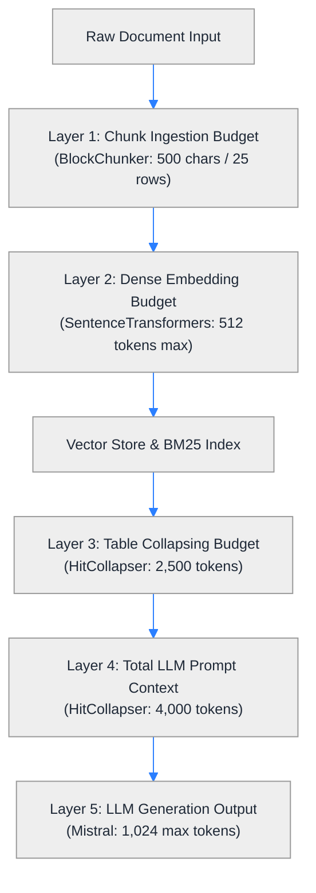
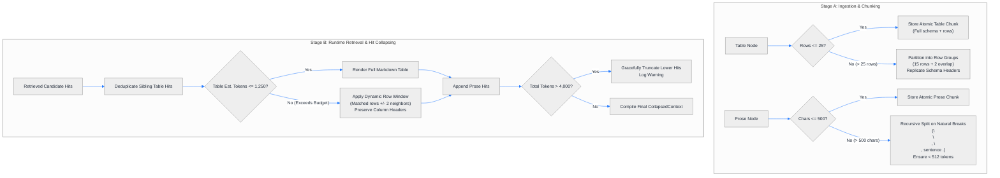

# Token Budget & Context Window Management Guide

## 1. Overview & Architectural Motivation

In modern Retrieval-Augmented Generation (RAG) systems, **token budgeting is not an afterthought—it is a core architectural constraint**. 

A naive RAG pipeline simply fetches the top-$K$ chunks and concatenates them directly into the LLM prompt. In real-world enterprise deployments, this approach breaks down quickly:
1. **The "Lost in the Middle" Dilemma**: Transformer self-attention degrades as context length increases. Critical facts placed in the middle of a 10,000+ token context window are frequently overlooked or hallucinated by LLMs.
2. **Silent Embedding Truncation**: Standard dense embedding models (e.g., `all-MiniLM-L6-v2`, `bge-small-en-v1.5`) have hard input sequence limits (typically 256 or 512 tokens). If an unbudgeted table or paragraph exceeds 512 tokens, the embedding model **silently chops off** the trailing text without raising an exception—permanently blinding semantic search to that data.
3. **Latency (TTFT) & API Costs**: Time-To-First-Token scales directly with prompt length. Uncontrolled context packing leads to multi-second response delays and runaway token billing.

This project implements a multi-tiered token management framework spanning **Ingestion**, **Vector Indexing**, and **Runtime Prompt Synthesis**.

---

## 2. Multi-Tier Token Hierarchy

The system enforces strict token boundaries across five distinct layers:



### Token Parameter Specifications

| Layer | Parameter | Default Value | Location | Description |
| :--- | :--- | :--- | :--- | :--- |
| **Ingestion (Prose)** | `chunk_size` / `chunk_overlap` | `500` / `50` chars | `config.yaml` | Target character size for prose chunks (~125 tokens). |
| **Ingestion (Tables)** | `max_atomic_rows` | `25` rows | `block_chunker.py` | Maximum rows before a table must be partitioned. |
| **Ingestion (Tables)** | `row_group_size` / `row_overlap`| `15` / `2` rows | `block_chunker.py` | Slice size and overlap for oversized multi-page tables. |
| **Embedding Engine** | Max Sequence Length | `512` tokens | Embedding Model | Hard truncation limit of `all-MiniLM-L6-v2`. |
| **Runtime (Tables)** | `table_token_budget` | `2,500` tokens | `hit_collapser.py` | Maximum prompt budget reserved for tabular context. |
| **Runtime (Prompt)** | `total_token_budget` | `4,000` tokens | `hit_collapser.py` | Hard ceiling for combined prose + table prompt context. |
| **LLM Generation** | `max_output_tokens` | `1,024` tokens | `config.yaml` | Maximum completion length generated by the LLM. |

---

## 3. What Happens When Budgets Are Exceeded?

The architecture handles oversized content adaptively at two different execution stages:



### Stage A: Ingestion & Chunking (`src/chunking/block_chunker.py`)

#### 1. Large Tables ($> 25$ Rows)
- **The Problem**: A 200-row financial ledger exceeds both the embedding model's 512-token limit and causes massive chunk bloat.
- **The Solution**: Oversized tables are partitioned into chunks of `15` rows with a `2`-row overlap (`DEFAULT_ROW_GROUP_SIZE` and `DEFAULT_ROW_OVERLAP`).
- **Schema Preservation**: Every sub-chunk replicates the complete table caption and column headers. Data rows are never orphaned without their column names.

#### 2. Oversized Prose Paragraphs ($> 500$ Characters)
- **The Problem**: Arbitrary hard character splits sever sentences in half and fragment thoughts.
- **The Solution**: Prose is split recursively using semantic hierarchy boundaries:
  `["\n\n", "\n", ". ", " ", ""]`
  with a 50-character sliding overlap, guaranteeing that individual chunks never exceed 512 tokens.

---

### Stage B: Runtime Hit Collapsing (`src/retrieval/hit_collapser.py`)

When top-$K$ retrieval fetches multiple hits across text and tables, `HitCollapser` synthesizes them into a compact context:

#### 1. Dynamic Table Row Windowing
If a 100-row table has hits in row 45 and row 46:
- If the entire table fits comfortably within half the table budget (`estimated_tokens <= table_token_budget // 2`, ~1,250 tokens), the **full table** is injected into the prompt for maximum completeness.
- If the full table exceeds that threshold, the collapser applies an **expansion window** (`row_expansion_window = 2`):
  $$\text{start} = \max(0, \text{min\_row} - 2), \quad \text{end} = \min(\text{total\_rows}, \text{max\_row} + 2)$$
- The prompt receives a compact, highly relevant excerpt with pristine column headers:
  ```markdown
  ### Table: Operating Expenses by Department (Rows 43-48 of 100)
  | Department | Q1 Expense | Q2 Expense | Growth |
  | Engineering | $1.2M | $1.4M | +16.6% |
  | Product | $450K | $490K | +8.8% |
  ...
  ```

#### 2. Total Context Budget Ceiling (4,000 Tokens)
- After tabular hits are formatted, prose hits are iteratively appended.
- `HitCollapser` tracks running tokens:
  ```python
  if current_tokens + est_tokens > self.total_token_budget:
      logger.warning("Token budget reached; truncating remaining prose hits.")
      break
  ```
- **Guaranteed Safety**: Lower-ranked, less relevant chunks are dropped cleanly. The LLM prompt is never rejected by API token limits.

---

## 4. Tuning Guide for Different Deployment Scenarios

Depending on your production LLM and cost profile, adjust `config.yaml` and `hit_collapser.py`:

| Production Scenario | Target Model | `table_token_budget` | `total_token_budget` | Reason |
| :--- | :--- | :--- | :--- | :--- |
| **Low-Cost / Local Edge** | `open-mistral-7b` / `llama-3-8b` | `1,500` | `2,500` | Keeps memory low, minimizes TTFT (<800ms), prevents attention distraction. |
| **Standard Enterprise (Default)** | `mistral-small-latest` / `gpt-4o-mini` | `2,500` | `4,000` | Optimal balance between multi-table context and generation speed. |
| **Long-Context Audit / Legal** | `gemini-1.5-pro` / `claude-3-5-sonnet` | `8,000` | `16,000` | Allows passing dozens of full multi-page tables simultaneously without row slicing. |

---

## 5. Summary Checklist for Engineers
- [x] **Individual chunks $\le 512$ tokens** to protect embedding vector quality.
- [x] **Tables $> 25$ rows partitioned** with repeated schema headers.
- [x] **Sibling table hits deduplicated** and merged into a single reference.
- [x] **Dynamic row slicing ($\pm 2$ window)** activated when full table exceeds 1,250 tokens.
- [x] **Prose truncated gracefully at 4,000 tokens** to prevent context window overflow.
