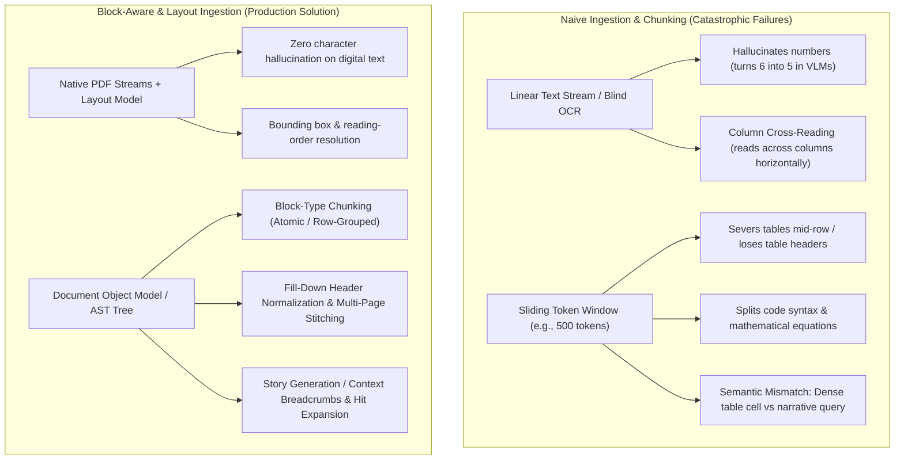
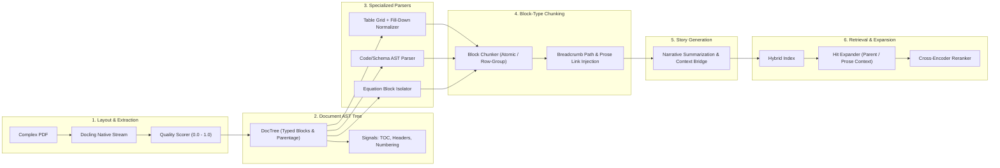
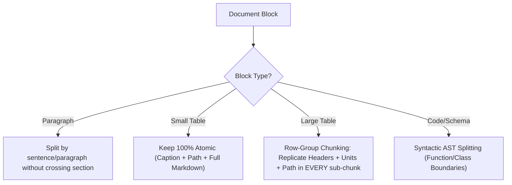
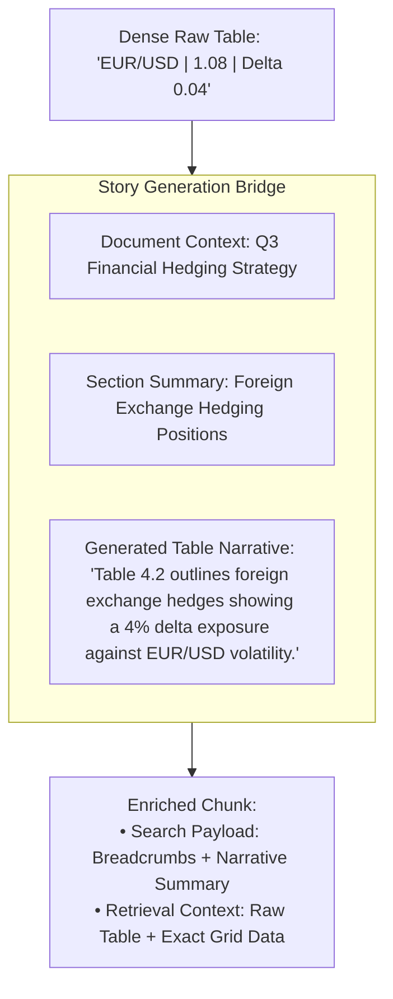

# Plan 7: Advanced Chunking & Ingestion for Complex Structured Documents

## 🎯 Objective
Design a production-grade ingestion and chunking architecture capable of handling **complex, data-heavy, structured documents** (financial filings, scientific papers, technical manuals, architectural specifications, and legal contracts). 

This plan synthesizes real-world production insights from industry practitioners: **layout-aware native extraction, Document Block Tree representation, multi-page table stitching with fill-down header normalization, syntactic code parsing, narrative context enrichment ("story generation"), retrieval-time hit expansion, and targeted regression evaluation**.

---

## 💥 The Core Dilemma: Why Naive Chunking Fails on Complex Documents



### Key Failure Modes
1. **Flattened Hierarchy & Lost Parentage**: A paragraph stating *"The liability limit is $50,000"* loses all meaning if separated from its parent heading *"Section 4.2: Exclusions for Tier 2 Vendors"*.
2. **Table Mutilation & Empty Merged Cells**: Flat markdown or split windows orphan data cells from their headers. Merged headers in multi-row columns yield empty strings in child rows unless explicitly forward-filled.
3. **VLM Character Hallucination**: Pure vision models rasterizing entire pages frequently misread numbers, formulas, and symbols (turning `6` into `5` or dropping minus signs), which is disastrous for legal, medical, or financial data.
4. **Semantic Query Mismatch**: User queries are narrative (*"How does company X handle foreign currency risks?"*), whereas data in documents is dense tabular or schematic data (*"EUR/USD | 1.08 | Delta 0.04"*). Without a narrative bridge ("story generation"), semantic retrieval misses the target.
5. **Geometry vs. Semantic Traps**: Visual proximity alone fails when text wraps around sidebars, figures, or footers.

---

## 🏗️ The 6-Layer Architecture



---

## 🧩 Detailed Architectural Layers

### Layer 1: Native Stream Extraction & Quality Scoring
* **Native Text Stream First**: Extract text primitives directly from the PDF stream using layout-aware engines like **Docling** (benchmarked superior to Camelot, pdfplumber, and PyMuPDF on merged-cell policy tables). Layout models are restricted strictly to predicting **reading order, bounding boxes, and column flows**, preventing vision hallucination on digital text.
* **Extraction Quality Score ($Q_{score} \in [0.0, 1.0]$)**:
  Compute an ingestion confidence score per document before indexing:
  $$Q_{score} = w_1 \cdot \text{NativeRatio} + w_2 \cdot \text{FontConsistency} + w_3 \cdot \text{CharDensity} - w_4 \cdot \text{OCRConfidenceLoss}$$
  - Documents scoring $< 0.65$ (e.g. poor scans, "napkin scratch") trigger OCR fallback or user warning, rather than silently polluting vector databases.

---

### Layer 2: The Document Schema Tree (Typed Block Tree)
Every extracted element is represented as a typed block rather than flat characters:

```python
class BlockType(str, Enum):
    ROOT = "root"
    SECTION = "section"
    PARAGRAPH = "paragraph"
    TABLE = "table"
    CODE = "code"
    EQUATION = "equation"
    LIST = "list"
    HEADER_FOOTER = "header_footer"

class DocumentNode(BaseModel):
    id: str
    node_type: BlockType
    content: str
    metadata: dict[str, Any]      # page_number, bbox (x0, y0, x1, y1), reading_order_idx
    parent_id: str | None = None
    children: list["DocumentNode"] = []
    level: int = 0                 # Heading depth (H1=1, H2=2, etc.)
    section_path: list[str] = []   # ["Chapter 1", "Section 1.2", "Pricing"]
    preceding_prose_id: str | None = None  # Pointer to preceding introductory paragraph
    table_metadata: dict[str, Any] | None = None # table_id, row_range, column_names, units
```

#### Disambiguating Visual vs. Semantic Boundaries
Geometry alone is unreliable. The tree builder settles region conflicts by cross-referencing:
- **Section Numbering**: Regex patterns (`1.`, `1.2`, `IV.A`) override physical gaps.
- **Table of Contents (TOC) Matching**: Extracted headings are validated against the document's native TOC outline.
- **Running Headers & Footers**: Pruned based on frequency/position across pages to prevent text fracture.
- **Repeated Table Header Rows**: Identified across page boundaries to trigger table continuation.

---

### Layer 3: Specialized Table & Code Parsers

#### A. Table Handling & The "Fill-Down" Normalizer
1. **The Multi-Row Header Fill-Down Pass**:
   - In multi-level headers (`colspan` / `rowspan`), underlying sub-cells often evaluate to `""` or `None`.
   - Implement an explicit **forward-fill / fill-down normalizer** that propagates parent headers downward and rightward.
   - Example: A top header `"2025 Financials"` spanning `"Q1"`, `"Q2"` produces compound column names: `["2025 Financials > Q1", "2025 Financials > Q2"]`.
2. **Multi-Page Table Stitching**:
   - Compare bottom boundary geometry of page $N$ with top boundary geometry of page $N+1$.
   - Compute column header signature similarity across page breaks.
   - Stitch rows into a single continuous entity before chunking.

#### B. Code & Schema AST Parsing
- For documents containing code, YAML, SQL, or JSON schemas, arbitrary token splits cause syntax breakage.
- Use language-aware AST chunking (e.g. `tree-sitter` or Python `ast`): split at class/function/block boundaries.

---

### Layer 4: Block-Type Chunking Engine

Stop sliding character windows across the document. Chunk strictly according to **BlockType**:



1. **Small Tables (< 30 rows / within token budget)**:
   - Kept strictly **atomic**. Never split.
2. **Large Tables (> 30 rows)**:
   - Chunked by **row or row-group** (e.g., 10–15 rows).
   - **Schema Replication**: Every sub-chunk must prepend:
     - Document ID & Section path (`[Doc > Section 4.1]`)
     - Table title / caption
     - Full normalized column headers + measurement units
     - Row slice range (e.g., `[Rows 30-45]`)
3. **Bi-directional Prose Linking**:
   - When a table is detected, link its `preceding_prose_id` to the paragraph immediately introducing it.

---

### Layer 5: Story Generation & Multilayered Summarization
Solves the **semantic mismatch** between natural-language user queries and dense technical artifacts:



- **Dual-Representation Indexing**:
  - Embed the **narrative summary + breadcrumbs** for high semantic similarity during vector retrieval.
  - Deliver the **exact structured table / pristine code block** to the LLM generation prompt for zero-error synthesis.

---

### Layer 6: Retrieval-Time Hit Expansion & Reranker Pairing

1. **Context Expansion (Small-to-Big Retrieval)**:
   - When a table row-chunk hits during search:
     - Automatically expand the context to pull the **table caption/header** and the **introductory preceding paragraph** (`preceding_prose_id`).
     - If the table is small and only one row matched, pull the **full atomic table**.
   - When a paragraph chunk hits, expand to inspect immediately adjacent referenced tables.
2. **Cross-Encoder / Reranker Pairing**:
   - Hybrid search retrieves top-30 candidates (Dense summary + Sparse BM25 on exact cell values).
   - Cross-encoder reranks expanded candidates based on query-to-breadcrumb and query-to-fact alignment.

---

### 🧪 Evaluation: The 25-Question Targeted Benchmark

Before overbuilding, validate chunking performance on a frozen 25-question evaluation set comparing **naive character chunking** against **block/table-aware chunking**:

| Category | Count | Focus / Validation Goal | Example Query |
| :--- | :--- | :--- | :--- |
| **Cell / Row Lookup** | 8 | Target specific cells, row headers, and units | *"What is the tier 2 deductible for Plan B?"* |
| **Table + Intro Context** | 7 | Requires both introductory prose and table data | *"Why did the capital adequacy ratio drop in Table 4?"* |
| **Narrative / Broad Synthesis**| 6 | Broad section-level queries that summarize prose | *"What are the primary geopolitical risks outlined?"* |
| **Negative Controls** | 4 | Questions that should NOT match the table | *"What are the exclusions for unlisted maritime vehicles?"* |

**Metric**: Measure **Retrieved Source Quality (Precision@K / NDCG@K)** on ground-truth blocks, not just final generated response accuracy.

---

## 🧪 Regression Testing: The "Ugly Table" Fixture

1. **The Frozen Fixture (`tests/fixtures/ugly_multipage_table.pdf`)**:
   - A multi-page PDF containing merged cells (`rowspan=3`, `colspan=2`), rotated text, multi-line headers, and a page-break mid-row.
2. **Automated Invariant Assertions**:
   - `test_table_no_lost_cells()`: Cell count and column alignment match ground truth before and after multi-page stitching.
   - `test_fill_down_headers()`: Assert no empty column names in sub-rows; multi-tier headers correctly compounded.
   - `test_reading_order_two_column()`: Multi-column layouts must never interleave paragraphs across columns.
   - `test_table_prose_link()`: Assert `preceding_prose_id` points to the introductory paragraph.

---

## 📋 Implementation Roadmap

| Phase | Milestone | Deliverables |
| :--- | :--- | :--- |
| **Phase 1: Document Block Tree & Quality Scorer** | Foundation | • `src/ingestion/doc_tree.py` (`BlockType`, `DocumentNode`, Tree builder)<br>• `src/ingestion/quality_scorer.py` ($Q_{score}$ calculation) |
| **Phase 2: Layout Parser & Fill-Down Normalizer** | Extraction & Prep | • `src/ingestion/layout_parser.py` (Docling / layout stream)<br>• `src/chunking/table_parser.py` (Fill-down multi-row header normalizer, multi-page stitcher) |
| **Phase 3: Block-Type Chunking Engine** | Core Chunking | • `src/chunking/block_chunker.py` (Atomic small tables, row-group sub-chunks with duplicated schema headers, prose pointer) |
| **Phase 4: Retrieval Hit Expander** | Retrieval | • `src/retrieval/hit_expander.py` (Small-to-big context expansion: table-to-prose, row-to-table) |
| **Phase 5: Story Generator & Reranker Pairing** | Semantic Alignment | • `src/chunking/story_generator.py` (Dual-representation narrative summaries)<br>• Hybrid retrieval + cross-encoder reranking |
| **Phase 6: Benchmark & Regression Suite** | Quality Assurance | • `tests/fixtures/ugly_multipage_table.pdf`<br>• `tests/test_block_chunking.py`<br>• 25-question retrieval evaluation script |
