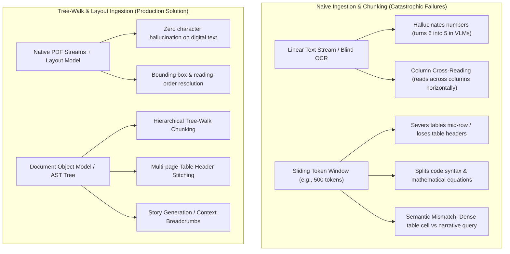
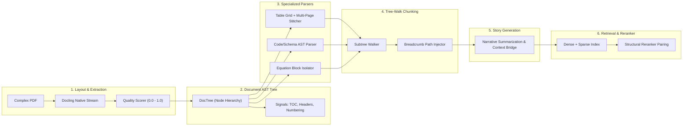
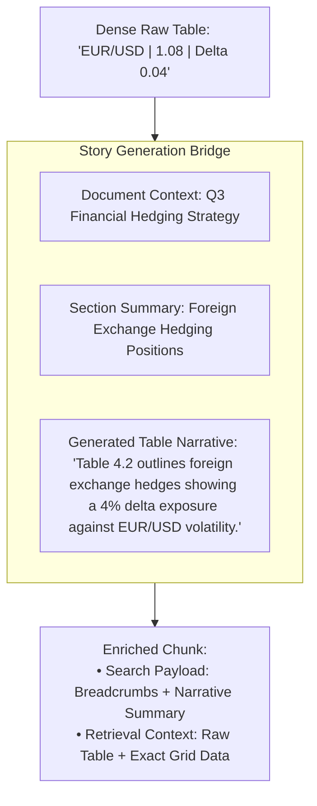

# Plan 7: Advanced Chunking & Ingestion for Complex Structured Documents

## 🎯 Objective
Design a production-grade ingestion and chunking architecture capable of handling **complex, data-heavy, structured documents** (financial filings, scientific papers, technical manuals, architectural specifications, and legal contracts). 

This plan addresses the catastrophic failure modes of naive token chunking and end-to-end vision extractors by synthesizing real-world production strategies: **layout-aware native extraction, Document Tree (AST) representation, multi-page table stitching, syntactic code parsing, narrative context enrichment ("story generation"), and regression testing fixtures**.

---

## 💥 The Core Dilemma: Why Naive Chunking Fails on Complex Documents



### Key Failure Modes
1. **Flattened Hierarchy & Lost Parentage**: A paragraph stating *"The liability limit is $50,000"* loses all meaning if separated from its parent heading *"Section 4.2: Exclusions for Tier 2 Vendors"*.
2. **Table Mutilation**: Flattened markdown or split windows orphan data cells from their headers. Multi-page tables lose column headers on page 2.
3. **VLM Character Hallucination**: Pure vision models rasterizing entire pages frequently misread numbers, formulas, and symbols (turning `6` into `5` or dropping minus signs), which is disastrous for legal, medical, or financial data.
4. **Semantic Query Mismatch**: User queries are narrative (*"How does company X handle foreign currency risks?"*), whereas data in documents is dense tabular or schematic data (*"EUR/USD | 1.08 | Delta 0.04"*). Without a narrative bridge ("story generation"), semantic retrieval misses the target.
5. **Geometry vs. Semantic Traps**: Visual proximity alone fails when text wraps around sidebars, figures, or footers.

---

## 🏗️ The 6-Layer Architecture



---

## 🧩 Detailed Architectural Layers

### Layer 1: Native Stream Extraction & Quality Scoring
* **Native Text Stream First**: Extract text primitives directly from the PDF stream using layout-aware engines like **Docling** (or `pdfminer.six` with layout analysis). Layout models are restricted strictly to predicting **reading order, bounding boxes, and column flows**, preventing vision hallucination on digital text.
* **Extraction Quality Score ($Q_{score} \in [0.0, 1.0]$)**:
  Compute an ingestion confidence score per document before indexing:
  $$Q_{score} = w_1 \cdot \text{NativeRatio} + w_2 \cdot \text{FontConsistency} + w_3 \cdot \text{CharDensity} - w_4 \cdot \text{OCRConfidenceLoss}$$
  - Documents scoring $< 0.65$ (e.g. poor scans, "napkin scratch") trigger OCR fallback or user warning, rather than silently polluting vector databases.

### Layer 2: The Document Schema Tree (DOM / Node Tree)
Every extracted element is represented as a structured node rather than flat text:

```python
class DocumentNode(BaseModel):
    id: str
    node_type: Literal["root", "section", "paragraph", "table", "code", "equation", "list", "header_footer"]
    content: str
    metadata: dict[str, Any]  # page_number, bbox (x0, y0, x1, y1), reading_order_idx
    parent_id: str | None = None
    children: list["DocumentNode"] = []
    level: int = 0             # Heading depth (H1=1, H2=2, etc.)
    section_path: list[str] = [] # ["Chapter 1", "Section 1.2", "Pricing"]
```

#### Disambiguating Visual vs. Semantic Boundaries
Geometry alone is unreliable. The tree builder settles region conflicts by cross-referencing:
- **Section Numbering**: Regex patterns (`1.`, `1.2`, `IV.A`) override physical gaps.
- **Table of Contents (TOC) Matching**: Extracted headings are validated against the document's native TOC outline.
- **Running Headers & Footers**: Detected by position frequency across pages and pruned so they do not fracture text flows.
- **Repeated Table Header Rows**: Identified across page boundaries to trigger table continuation.

---

### Layer 3: Specialized Element Parsers

#### A. Native Table Extraction & Multi-Page Stitching
1. **Grid Representation**: Tables are parsed into structured cell objects preserving `rowspan`, `colspan`, and multi-level column headers, rather than naive Markdown pipe tables.
2. **Multi-Page Table Stitching**:
   - Compare bottom boundary geometry of page $N$ with top boundary geometry of page $N+1$.
   - Compute column header signature similarity across both tables.
   - If signatures match and vertical gap aligns with page break, stitch rows into a single continuous table entity before chunking.
3. **Table Chunking Strategy**:
   - For giant tables, chunk by row batches while **duplicating header rows and column definitions** into every chunk.

#### B. Code & Schema AST Parsing
- For documents containing code, YAML, SQL, or JSON schemas, arbitrary token splits cause syntax breakage.
- Use language-aware AST chunking (e.g. `tree-sitter` or Python `ast`): split at class/function/block boundaries.

---

### Layer 4: Tree-Walk Chunking Engine
Instead of a sliding character/token window, chunking performs an **adaptive traversal of the Document Tree**:

1. **Subtree Consolidation**:
   - If a section subtree (Heading + children) fits within the maximum token budget ($T_{max} \approx 600$), keep it as a single coherent chunk.
2. **Recursive Descent**:
   - If a section exceeds $T_{max}$, preserve the section root, step into its child nodes (paragraphs, sub-tables), and group sibling nodes without crossing section boundaries.
3. **Hierarchical Breadcrumb Injection**:
   Every generated chunk is prefixed with its full document lineage:
   ```markdown
   [Document: 2025_Annual_Report.pdf > Section 4: Risk Management > 4.2 Liquidity Risk > Table 4.2]
   <Chunk Content>
   ```

---

### Layer 5: Story Generation & Multilayered Summarization
Solves the **semantic mismatch** between natural-language user queries and dense technical artifacts:



- **Multilayered Context**:
  - High-level document thesis (Document Level).
  - Immediate section objective (Section Level).
  - Synthetic description / narrative explanation of dense tables, formulas, or code snippets.
- **Dual-Representation Indexing**:
  - Embed the **narrative summary + breadcrumbs** for high semantic similarity during vector retrieval.
  - Deliver the **exact structured table / pristine code block** to the LLM generation prompt for zero-error synthesis.

---

### Layer 6: Smart Ingestion Paired with Rerankers
- Standard bi-encoders (dense vector search) struggle with structured metadata.
- **Cross-Encoder / Reranker Pairing**:
  - Retrieve top-30 candidates using hybrid search (Dense embeddings of narrative summaries + BM25 keyword matching on exact cell values).
  - Pass candidate chunks (including their hierarchical breadcrumbs and table structures) to a cross-encoder reranker (e.g. `bge-reranker-large` or `Cohere Rerank 3`).
  - The cross-encoder resolves the joint attention between the query and both the narrative breadcrumb and the dense facts.

---

## 🧪 Regression Testing & The "Ugly Table" Fixture

As noted in production practice, structural extractors degrade quickly without strict regression fixtures:

1. **The Frozen Fixture (`tests/fixtures/ugly_multipage_table.pdf`)**:
   - A multi-page PDF containing merged cells (`rowspan=3`, `colspan=2`), rotated text, multi-line headers, and a page-break mid-row.
2. **Automated Invariant Assertions**:
   - `test_table_no_lost_cells()`: Cell count and column alignment match ground truth before and after multi-page stitching.
   - `test_reading_order_two_column()`: Multi-column layouts must never interleave paragraphs across columns.
   - `test_section_tree_integrity()`: Verify every child node correctly traces back to its parent header in the TOC.
   - `test_zero_number_hallucination()`: Compare raw stream digit set against extracted tokens to verify $100\%$ numerical fidelity.

---

## 📋 Implementation Roadmap

| Phase | Milestone | Deliverables |
| :--- | :--- | :--- |
| **Phase 1: Document Tree Schema & Quality Scorer** | Foundation | • `src/ingestion/doc_tree.py` (`DocumentNode`, Tree builder)<br>• `src/ingestion/quality_scorer.py` ($Q_{score}$ calculation) |
| **Phase 2: Layout Parser & Signal Extractor** | Extraction | • Layout-aware extractor (`src/ingestion/layout_parser.py`)<br>• Section numbering, TOC, and header/footer signal resolver |
| **Phase 3: Specialized Table & Code AST Parsers** | Structure | • `src/chunking/table_parser.py` (Cell grid, multi-page stitcher)<br>• `src/chunking/ast_chunker.py` (Syntactic code & schema splitter) |
| **Phase 4: Tree-Walk Chunking & Breadcrumbs** | Chunking | • `src/chunking/tree_chunker.py` (Subtree traversal, lineage breadcrumb injection) |
| **Phase 5: Story Generation & Context Enrichment** | Semantic Alignment | • `src/chunking/story_generator.py` (Multilayered section/table summaries) |
| **Phase 6: Regression Test Suite** | Reliability | • `tests/fixtures/ugly_multipage_table.pdf`<br>• `tests/test_structured_chunking.py` verifying invariants |
