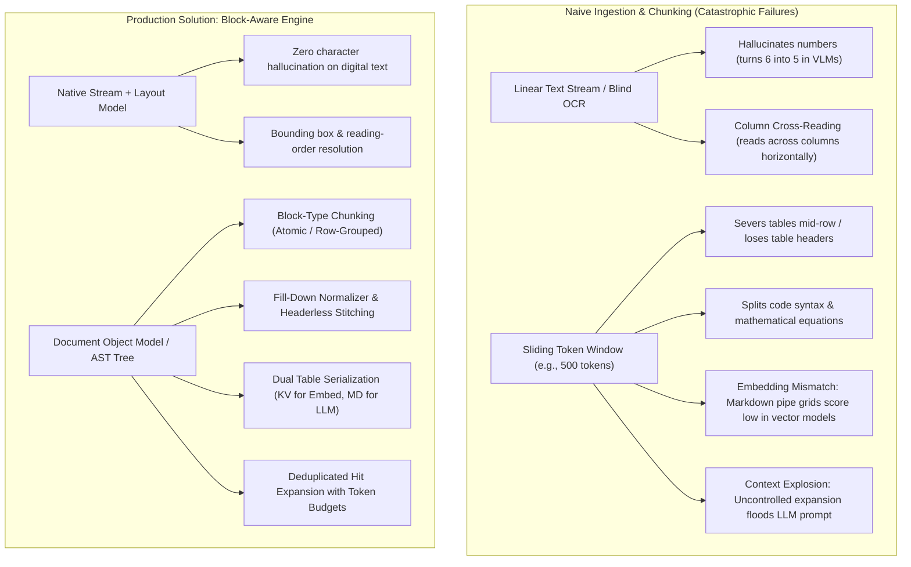
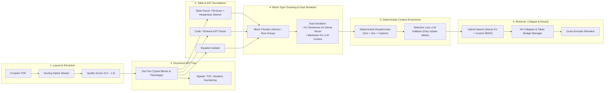
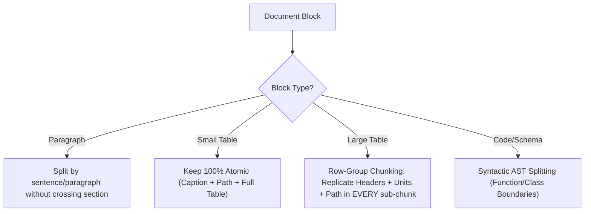
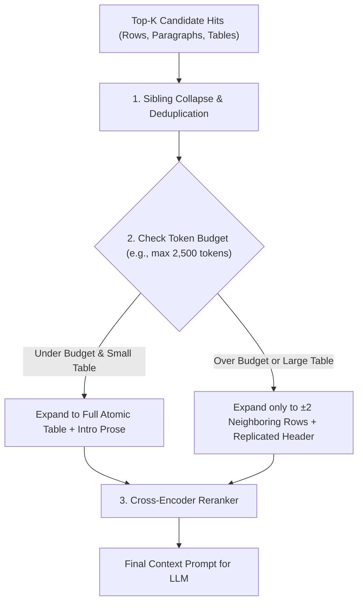

# Plan 7: Advanced Chunking & Ingestion for Complex Structured Documents

## 🎯 Objective
Design a production-grade ingestion and chunking architecture capable of handling **complex, data-heavy, structured documents** (financial filings, scientific papers, technical manuals, architectural specifications, and legal contracts). 

This plan synthesizes real-world production insights into an operationally resilient, cost-effective pipeline: **layout-aware native extraction, Document Block Tree representation, multi-page table stitching (with headerless fallbacks and fill-down normalization), dual-format table serialization for embeddings, runtime hit deduplication with token budgeting, and a 25-question empirical evaluation suite**.

---

## 💥 The Core Dilemma: Why Naive Chunking Fails on Complex Documents



### Key Failure Modes Addressed
1. **Flattened Hierarchy & Lost Parentage**: Detaching facts from enclosing section headers strips operational context.
2. **Table Mutilation & Empty Merged Cells**: Multi-row headers produce empty strings in sub-cells unless explicitly filled down.
3. **Markdown Pipe Embedding Mismatch**: Embedding models trained on prose poorly match raw ASCII pipe grids (`| --- | --- |`).
4. **VLM Character Hallucination**: End-to-end vision models misread numbers/minus signs on data-heavy PDFs.
5. **Runtime Context Explosion**: Expanding hits without deduplication floods the prompt when multiple rows from the same table match.
6. **Headerless Page Spills**: Over 40% of continued tables in real-world PDFs omit headers on page 2.

---

## 🏗️ The Production Architecture



---

## 🧩 Detailed Architectural Layers

### Layer 1: Native Stream Extraction & Quality Scoring
* **Native Text Stream First**: Extract text primitives directly from the PDF stream using layout-aware engines like **Docling** (benchmarked superior to Camelot, pdfplumber, and PyMuPDF on merged-cell policy tables). Layout models are restricted strictly to predicting **reading order, bounding boxes, and column flows**, preventing vision hallucination on digital text.
* **Extraction Quality Score ($Q_{score} \in [0.0, 1.0]$)**:
  Compute an ingestion confidence score per document before indexing:
  $$Q_{score} = w_1 \cdot \text{NativeRatio} + w_2 \cdot \text{FontConsistency} + w_3 \cdot \text{CharDensity} - w_4 \cdot \text{OCRConfidenceLoss}$$
  - If $Q_{score} < 0.65$ (e.g., degraded scans), route to specialized layout-aware table OCR (Surya/PaddleOCR Table) or return an actionable ingestion warning.

---

### Layer 2: The Document Schema Tree (Typed Block Tree)
Every extracted element is represented as a typed block rather than flat characters:

```python
class BlockType(str, Enum):
    ROOT = "root"
    SECTION = "section"
    PARAGRAPH = "paragraph"
    TABLE = "table"
    CODE = "code"
    EQUATION = "equation"
    LIST = "list"
    HEADER_FOOTER = "header_footer"

class DocumentNode(BaseModel):
    id: str
    node_type: BlockType
    content: str
    metadata: dict[str, Any]      # page_number, bbox (x0, y0, x1, y1), reading_order_idx
    parent_id: str | None = None
    children: list["DocumentNode"] = []
    level: int = 0                 # Heading depth (H1=1, H2=2, etc.)
    section_path: list[str] = []   # ["Chapter 1", "Section 1.2", "Pricing"]
    preceding_prose_id: str | None = None  # Pointer to preceding introductory paragraph
    table_metadata: dict[str, Any] | None = None # table_id, row_range, column_names, units
```

#### Disambiguating Visual vs. Semantic Boundaries (Docling + Regex Architecture)

> [!NOTE]
> **Architectural Separation of Concerns:**
> 1. **Docling Vision & Layout Models (Primary Authority)**:
>    - Owns 100% of Table cell structures, row/col spans, bounding boxes, and reading-order flow.
>    - Directly classifies visually distinct headers (`SectionHeaderItem`) based on font weight, size, and layout geometry.
> 2. **Regex Semantic Validators (Secondary Signal Resolver)**:
>    - **Does NOT replace or interfere with Docling**: Never alters Docling tables, code blocks, or visual headers.
>    - Resolves the "small-font heading" trap: When legal or technical documents use numbered sub-clauses (e.g., `1.2.3 Limitation of Liability`) formatted in identical font size and weight as body text, Docling's vision model tags them as generic `TextItem` (body text).
>    - The regex pattern strictly inspects these generic `TextItem`s for explicit numbering schemes (`1.1`, `Chapter 1`, `Article IV`) to elevate them into `BlockType.SECTION`, preserving hierarchical chunk lineage and breadcrumbs.

- **Section Numbering**: Regex patterns (`1.`, `1.2`, `IV.A`) settle semantic boundaries when visual geometry is uniform.
- **Table of Contents (TOC) Matching**: Extracted headings are validated against the document's native TOC outline.
- **Running Headers & Footers**: Pruned based on frequency/position across pages to prevent text fracture.
- **Repeated Table Header Rows**: Identified across page boundaries to trigger table continuation.

---

### Layer 3: Specialized Table Parsers (Fill-Down & Headerless Stitching)

#### A. The Multi-Row Header Fill-Down Pass
- In multi-level headers (`colspan` / `rowspan`), underlying sub-cells often evaluate to `""` or `None`.
- The **Forward-Fill Normalizer** propagates parent headers downward and rightward.
- Example: Top header `"2025 Financials"` spanning `"Q1"`, `"Q2"` produces compound column names:  
  `["2025 Financials > Q1", "2025 Financials > Q2"]`.

#### B. Multi-Page Table Stitching with Headerless Fallback
1. **Rule A (Header Signature Matching)**: If page $N+1$ begins with the same column headers as page $N$, stitch rows continuously.
2. **Rule B (Headerless Spillover Fallback)**: If page $N$ table cuts off near the bottom margin ($y_1 > 0.85$) and page $N+1$ begins at the top margin ($y_0 < 0.15$) with:
   - Identical column counts, and
   - Compatible data-type signatures (e.g. Col 1 is string, Col 2-4 are floats),
   treat it as an immediate continuation and adopt the header schema from page $N$.

---

### Layer 4: Block-Type Chunking & Dual Serialization

Stop sliding character windows across the document. Chunk strictly according to **BlockType**:



1. **Small Tables (< 30 rows / within token budget)**:
   - Kept strictly **atomic**. Never split.
2. **Large Tables (> 30 rows)**:
   - Chunked by **row or row-group** (e.g., 10–15 rows).
   - **Schema Replication**: Every sub-chunk prepends:
     - Document ID & Section path (`[Doc > Section 4.1]`)
     - Table title / caption
     - Full normalized column headers + measurement units
     - Row slice range (e.g., `[Rows 30-45]`)

#### 🔑 Dual Serialization Strategy for Tables
Dense bi-encoders score poorly on ASCII pipe tables (`| --- | --- |`). We generate **two distinct representations per table chunk**:

1. **Dense Vector Search Representation (Key-Value Linearization)**:
   ```text
   Document: 2025_Annual_Report.pdf > Section 4.1: Hedging Positions > Table 3: FX Options
   Row 5: Currency Pair: EUR/USD; Contract Type: Put; Strike: 1.08; Notional: $50M; Delta: 0.04
   Row 6: Currency Pair: GBP/USD; Contract Type: Call; Strike: 1.25; Notional: $30M; Delta: 0.12
   ```
2. **LLM Generation Payload**:
   Pristine Markdown pipe table or HTML grid for clean LLM reasoning.
3. **Punctuation-Preserving Sparse Tokenizer (BM25)**:
   Preserve financial/scientific symbols (`$`, `%`, `<`, `>`, `-`, `/`) during BM25 indexing so numerical cell queries match.

---

### Layer 5: Cost-Effective Context Enrichment (Deterministic First)

To avoid high latency and API bill shock, do not blindly call LLMs for every table:

1. **Level 1 (Deterministic & Free - 90% of Cases)**:
   - Prepend full Section Lineage + Document Title + Table Title + Preceding Introductory Prose (`preceding_prose_id`).
   - This provides sufficient narrative context for semantic search without incurring LLM API costs.
2. **Level 2 (Lazy / Selective LLM Fallback - 10% of Cases)**:
   - Trigger an LLM "Story / Takeaway Generation" call **only** for "orphan" tables (tables that lack a title, have no preceding prose, and contain dense numerical acronyms).

---

### Layer 6: Retrieval-Time Hit Collapser & Token Budget Manager



1. **Sibling Deduplication**:
   - If multiple retrieved chunks belong to the **same table ID**, collapse them into a single consolidated table reference. Never inject the same table multiple times into the prompt.
2. **Dynamic Context Budgeting**:
   - Set a maximum table token budget (e.g., 2,500 tokens).
   - If a table is small ($\le 1,000$ tokens), expand to the **full atomic table + introductory prose**.
   - If a table is large, expand only to the **retrieved rows $\pm 2$ neighboring rows + schema header**.
3. **Cross-Encoder Reranker**:
   - Scores the collapsed, expanded context against the user query before passing to the generator.

---

### 🧪 Evaluation: The 25-Question Empirical Benchmark

Before overbuilding, validate chunking performance on a frozen 25-question evaluation set comparing **naive character chunking** against **block/table-aware chunking**:

| Category | Count | Focus / Validation Goal | Example Query |
| :--- | :--- | :--- | :--- |
| **Cell / Row Lookup** | 8 | Target specific cells, row headers, and units | *"What is the tier 2 deductible for Plan B?"* |
| **Table + Intro Context** | 7 | Requires both introductory prose and table data | *"Why did the capital adequacy ratio drop in Table 4?"* |
| **Narrative / Broad Synthesis**| 6 | Broad section-level queries that summarize prose | *"What are the primary geopolitical risks outlined?"* |
| **Negative Controls** | 4 | Questions that should NOT match the table | *"What are the exclusions for unlisted maritime vehicles?"* |

**Evaluation Metric**: Measure **Retrieved Source Quality (NDCG@5 / Precision@5)** on ground-truth blocks, not just final answer accuracy.

---

## 🧪 Regression Testing: The "Ugly Table" Fixture

1. **The Frozen Fixture (`tests/fixtures/ugly_multipage_table.pdf`)**:
   - A multi-page PDF containing merged cells (`rowspan=3`, `colspan=2`), rotated text, multi-line headers, and page breaks mid-row without repeated headers.
2. **Automated Invariant Assertions**:
   - `test_table_no_lost_cells()`: Cell count and column alignment match ground truth before and after multi-page stitching.
   - `test_fill_down_headers()`: Assert no empty column names in sub-rows; multi-tier headers correctly compounded.
   - `test_headerless_continuation()`: Correctly stitches page 2 table rows when header is omitted on page 2.
   - `test_dual_serialization()`: KV string generated for vector indexing; Markdown generated for prompt context.
   - `test_hit_deduplication()`: Multiple row hits from same table collapse to a single instance without exceeding token budget.

---

## 📋 Implementation Roadmap & Status

| Phase | Milestone | Deliverables | Status |
| :--- | :--- | :--- | :---: |
| **Phase 1: Document Block Tree & Quality Scorer** | Foundation | • `src/ingestion/doc_tree.py` (`BlockType`, `DocumentNode`, Tree builder)<br>• `src/ingestion/quality_scorer.py` ($Q_{score}$ calculation)<br>• `src/ingestion/layout_parser.py` (Dedicated Docling engine) | **DONE ✅** |
| **Phase 2: Table Normalizer & Dual Serializer** | Extraction & Format | • `src/chunking/table_parser.py` (Fill-down normalizer, headerless multi-page stitcher, `from_docling_table`)<br>• `src/chunking/table_serializer.py` (KV string for embedding, Markdown for LLM) | **DONE ✅** |
| **Phase 3: Block-Type Chunking Engine** | Core Chunking | • `src/chunking/block_chunker.py` (Atomic small tables, row-group sub-chunks with duplicated schema headers, prose pointer) | **DONE ✅** |
| **Phase 4: Hit Collapser & Token Budgeter** | Runtime Retrieval | • `src/retrieval/hit_collapser.py` (Sibling deduplication, dynamic $\pm 2$ row expansion, token cap) | **DONE ✅** |
| **Phase 5: Benchmark & Regression Suite** | Quality Assurance | • `tests/fixtures/ugly_multipage_table.docx` (Multi-page test fixture)<br>• `tests/test_ugly_table_fixture.py` (Invariant regression tests)<br>• `scripts/eval_chunking_benchmark.py` (25-question retrieval benchmark)<br>• `reports/chunking_benchmark_report.md` (Benchmark evaluation report) | **DONE ✅** |
| **Phase 6: Lazy LLM Story Fallback (Optional)** | Enhancement | • `src/chunking/story_generator.py` (Only for orphan tables if benchmark indicates need) | **PENDING ⚪** |
