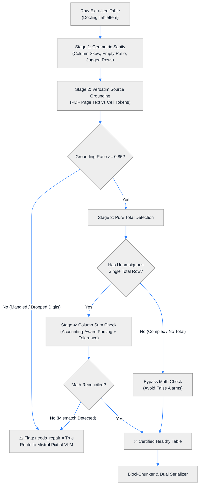

# Plan 8: Advanced Table Health Verification (Verbatim Source Grounding & Pure Total Reconciliation)

## 🎯 Objective
Elevate the automated table health diagnostic engine (`TableSanityChecker`) beyond basic token length skew and empty-cell ratios by implementing two high-precision, non-heuristic verification layers:
1. **Verbatim Source Grounding (Lexical Sanity)**: Verify that numbers and tokens in extracted tables actually appear on the source PDF page, catching OCR hallucinations and dropped digits.
2. **Simple "Pure" Total Row Reconciliation (Mathematical Sanity)**: Verify that numerical columns sum up to unambiguous bottom `Total` rows, incorporating accounting brackets `(150,000)` and rounding tolerances.
3. **Complex Nested Balances (Deliberately Out of Scope)**: Explicitly discard multi-tier nested subtotals (e.g., Subtotal 1 + Subtotal 2 + Grand Total) to avoid false-positive error cascades from double-counting.

---

## 🏗️ Architectural Workflow

---

## 🔬 Component Breakdown

### 1. Verbatim Source Grounding (`check_verbatim_grounding`)
- **Engine**: Uses `pypdfium2` to extract the raw page text layer directly from the underlying PDF in $< 2\text{ ms}$.
- **Token Extraction**: Normalizes numbers and alphanumeric strings from the source page into a lookup set (`raw_page_tokens`).
- **Cell Verification**:
  - Iterates through non-empty data cells in the extracted table.
  - Strips currency symbols (`$`, `£`, `€`) and thousands commas (`250,000` $\rightarrow$ `250000`).
  - Checks if extracted numbers and distinct entities exist in `raw_page_tokens`.
- **Decision Threshold**:
  $$\text{grounding\_ratio} = \frac{\text{grounded tokens}}{\text{total checked tokens}}$$
  If $\text{grounding\_ratio} < 0.85$, the table is flagged for VLM repair.

### 2. Simple "Pure" Total Reconciliation (`check_pure_total_math`)
- **Pure Total Detection**:
  - Scans the final 2 rows for keywords: `["total", "sum", "overall"]`.
  - Rejection Filter: If intermediate rows contain `["subtotal", "sub-total", "operating total", "balance"]`, the table has nested tiers and is **bypassed** to avoid false positives.
- **Accounting-Aware Number Parser**:
  - Parentheses notation: `(150,000)` $\rightarrow$ `-150000.0`
  - Footnote detachment: `35.91 1` $\rightarrow$ `35.91`
  - Decimal and integer normalization.
- **Tolerant Equality Check**:
  - Allows an absolute tolerance $\epsilon \le 2.0$ to accommodate published rounding discrepancies (e.g. $1.44 + 1.44 = 2.88 \rightarrow 2.9$).
  - If $\left| \sum \text{items} - \text{Total} \right| > \epsilon$, triggers structural repair flag.

### 3. Deliberately Out of Scope: Complex Nested Balances
- Multi-tier financial balance sheets (e.g., Current Assets subtotal + Non-Current Assets subtotal = Total Assets) frequently involve non-additive accounting conventions, equity balances, and multi-tier sub-grids.
- **Design Decision**: Rather than attempting fragile heuristic tree parsing of nested balances, the system preserves architectural simplicity: it relies on Verbatim Grounding and Geometric Checks for nested tables, bypassing arithmetic summation.

---

## 📁 Files to Modify & Create

1. **`src/ingestion/quality_scorer.py`**:
   - Enhance `TableSanityChecker` with `evaluate_table_advanced(...)`.
   - Add `_check_verbatim_grounding(pdf_path, page_number, rows)`.
   - Add `_check_pure_total_math(headers, rows)`.
   - Update `TableHealthReport` to include `grounding_ratio`, `math_reconciled`, and diagnostic details.
2. **`tests/test_table_health.py`**:
   - Unit test: Verbatim grounding pass on real PDF page.
   - Unit test: Verbatim grounding failure when digits are corrupted.
   - Unit test: Pure total math reconciliation pass with accounting parentheses.
   - Unit test: Pure total math mismatch triggering repair flag.
   - Unit test: Nested subtotal table correctly bypassed without false alarm.
3. **`scripts/test_pdf_chunking.py`**:
   - Wire advanced sanity check into the CLI inspection output.
4. **`docs/CHUNKING_AND_INGESTION_ARCHITECTURE.md`**:
   - Document Stage 3's advanced lexical grounding and pure total math verification rules.

---

## 📋 Task Checklist

- [ ] Implement `_check_verbatim_grounding` in `src/ingestion/quality_scorer.py`.
- [ ] Implement `_check_pure_total_math` in `src/ingestion/quality_scorer.py`.
- [ ] Extend `TableHealthReport` with new diagnostic fields.
- [ ] Update `tests/test_table_health.py` with comprehensive test cases.
- [ ] Run `pytest tests/test_table_health.py` and ensure 100% pass rate.
- [ ] Update `scripts/test_pdf_chunking.py` to display lexical and math health.
- [ ] Update documentation in `docs/CHUNKING_AND_INGESTION_ARCHITECTURE.md`.
- [ ] Commit and push changes with clean git history.
