# Plan 9: Evaluation Decoupling (Abstention vs. Hit Rate) & VLM Reconstruction Verification

## 🎯 Objective
Address critical architectural and evaluative refinements identified through peer review:
1. **Evaluation Decoupling (Answerable Hit Rate vs. Negative Abstention)**: Isolate retrieval recall and hit rate strictly to answerable queries, while evaluating negative / out-of-scope test cases via a dedicated **Abstention Accuracy** metric. Prevent unanswerable test queries from artificially penalizing retrieval performance.
2. **VLM Reconstruction Loop-Back Verification**: Prevent vision model hallucinations from contaminating the index by passing VLM-repaired tables back through `TableSanityChecker` (verbatim source grounding + arithmetic reconciliation) before accepting them.
3. **Data Cell Invariance (Span-Aware Preservation)**: Ensure table header normalization operates strictly on multi-tier header rows, keeping explicit empty data cells intact to prevent invented financial values.
4. **Documentation & Metrics Distinction**: Formally document the distinction between inference cost budgeting (e.g., 5% escalation target) and structural detection accuracy (confusion matrix of broken table recall vs. false alarms).

---

## 🏗️ Architectural Workflow

```mermaid
%%{init: {'theme': 'neutral', 'themeVariables': { 'fontSize': '13px', 'lineColor': '#2b7fff', 'edgeLabelBackground': '#ffffff', 'textColor': '#1f2937' }, 'flowchart': { 'nodeSpacing': 30, 'rankSpacing': 40, 'padding': 15, 'useMaxWidth': true } } }%%
flowchart TD
    subgraph S1["1. Evaluator Architecture"]
        Q["Query & Ground Truth Input"] --> QC{"Has ground_truth_ids<br/>or is_negative=False?"}
        QC -->|"Yes (Answerable)"| R1["Compute Retrieval Metrics<br/>Hit Rate@K, MRR, Precision, Recall"]
        QC -->|"No (Negative/Out-of-Scope)"| R2["Compute Abstention Metric<br/>Correct Refusal / 'No info' Fidelity"]
        R1 --> AGG["Scorecard Aggregation<br/>(Cleanly Separated Metrics)"]
        R2 --> AGG
    end

    subgraph S2["2. Table Repair Loop-Back Verification"]
        DEG["Degraded Table Detected<br/>(needs_repair = True)"] --> VLM["Call Pixtral VLM<br/>Extract Reconstructed Grid"]
        VLM --> PARSE["Parse Reconstructed<br/>Headers & Rows"]
        PARSE --> CHK["Re-run TableSanityChecker<br/>(Verbatim Grounding + Column Math)"]
        CHK --> PASS{"Reconstructed Table<br/>passes sanity?"}
        PASS -->|"Yes"| ACCEPT["✅ Accept Repair<br/>repaired = True<br/>Update DocumentNode"]
        PASS -->|"No"| REJECT["❌ Reject Repair<br/>method = 'vlm_validation_failed'<br/>Retain Original + Flag Warning"]
    end
```

---

## 🔬 Component Breakdown

### 1. Evaluator Decoupling (`src/evaluation/evaluator.py` & `retrieval_metrics.py`)
- **Problem**: In batch evaluation, queries with empty `ground_truth_ids` (negative/unanswerable test cases) yield 0 hits, pulling down aggregate Hit Rate and Recall even when the retriever is functioning properly.
- **Solution**:
  - Filter `retrieval_batch` to include only answerable cases (`len(ground_truth_ids) > 0` and `not is_negative`).
  - Calculate `retrieval_metrics` strictly over answerable cases.
  - For negative cases, evaluate **Abstention Accuracy**:
    - Check if the generated response correctly expresses refusal/uncertainty (e.g., contains standard abstention patterns: *"not mentioned"*, *"does not provide"*, *"cannot be determined"*, *"no information"*, or matches ground truth refusal).
  - Return distinct scorecard sections:
    - `retrieval_metrics`: Evaluated solely on answerable questions.
    - `abstention_metrics`: Total negative queries, correct abstentions, and `abstention_accuracy`.

### 2. VLM Reconstruction Loop-Back Verification (`src/chunking/table_repairer.py`)
- **Problem**: When a broken table is sent to Pixtral VLM, the VLM might fix the layout but hallucinate altered digits or alter column arithmetic.
- **Solution**:
  - When `TableParser.parse_markdown_table(raw_text)` succeeds, run the resulting `headers` and `rows` back through `self.checker.evaluate_table(node.id, headers, rows, pdf_path=pdf_path, page_number=page_no)`.
  - If `post_repair_report.needs_repair` is `True`:
    - Reject the VLM repair (`repaired=False`, `method="vlm_validation_failed"`).
    - Log an explicit warning and attach `post_repair_report` to `RepairResult`.
    - Retain the original table in the AST to preserve raw data provenance rather than introducing corrupted vision hallucinations.
  - If `post_repair_report.needs_repair` is `False`:
    - Accept the VLM repair (`repaired=True`).

### 3. Data Cell Preservation Validation (`src/chunking/table_parser.py`)
- **Verification**: Verify that `fill_down_headers` operates strictly on column headers and that table normalization routines never perform naive forward-fill across data rows.
- Ensure synthetic fixtures with empty data cells retain `""` / `None` without propagating previous row values.

### 4. Documentation & Operational Distinction
- Update `docs/EVALUATION_METRICS_GUIDE.md`:
  - Detail the separation between Answerable Retrieval Hit Rate and Negative Query Abstention Accuracy.
  - Explain the conceptual difference between the 5% VLM escalation target (cost SLA) vs. detection accuracy (Recall / Precision on broken tables).

---

## 📁 Files to Modify & Create

1. **`src/evaluation/evaluator.py`**:
   - Decouple answerable retrieval evaluation from negative query abstention evaluation.
   - Add `abstention_metrics` to evaluation scorecard.
2. **`src/chunking/table_repairer.py`**:
   - Implement loop-back verification of VLM-reconstructed tables using `self.checker.evaluate_table()`.
   - Add `validation_report` to `RepairResult`.
3. **`tests/test_evaluation.py`**:
   - Add unit tests verifying that unanswerable queries do not penalize retrieval Hit Rate and that abstention is scored independently.
4. **`tests/test_table_repairer.py`**:
   - Add unit test for VLM reconstruction validation pass and loop-back rejection when VLM hallucinates corrupted totals.
5. **`docs/EVALUATION_METRICS_GUIDE.md`**:
   - Document decoupled evaluation metrics and cost vs. detection quality distinction.
6. **`README.md`**:
   - Add Plan 9 to the architectural roadmap.

---

## 📋 Task Checklist

- [ ] Update `src/evaluation/evaluator.py` to decouple answerable retrieval from negative case abstention.
- [ ] Add `abstention_accuracy` calculation and update `RAGEvaluator.evaluate_batch`.
- [ ] Update `src/chunking/table_repairer.py` to re-verify VLM reconstructed tables via `TableSanityChecker`.
- [ ] Add unit tests in `tests/test_evaluation.py` for decoupled retrieval & abstention scoring.
- [ ] Add unit tests in `tests/test_table_repairer.py` for VLM loop-back validation and rejection.
- [ ] Verify full test suite passes (`pytest -v`).
- [ ] Update documentation in `docs/EVALUATION_METRICS_GUIDE.md` and `README.md`.
- [ ] Commit and push changes.
